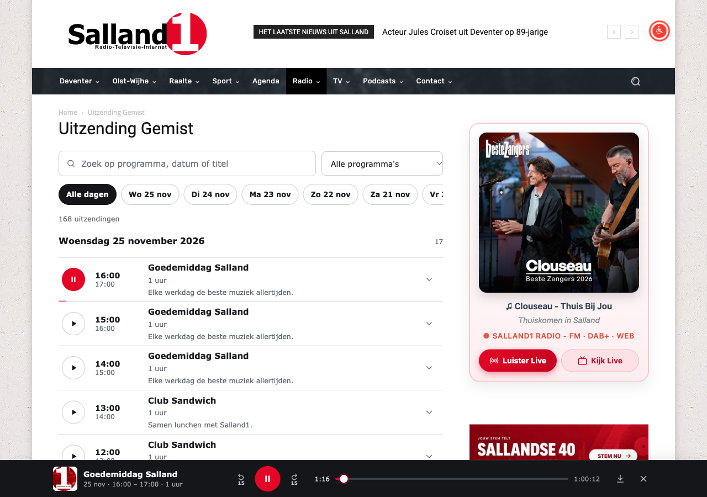
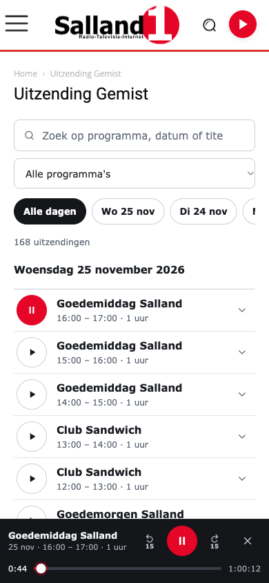
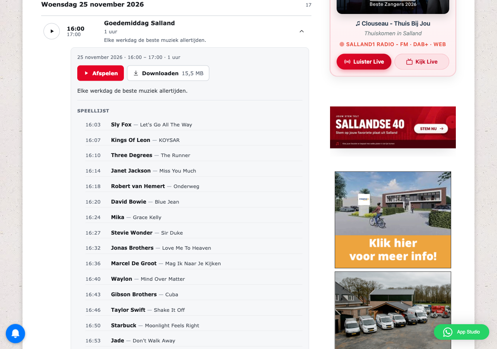

# Broadcast Archive

Turn any radio station's podcast or archive feed into a fast, searchable
"listen again" page in WordPress: day-grouped schedule, search, programme and
day filters, one persistent player, resumes where you stopped, and downloads.

The plugin is station-neutral. Feed URL, station name, accent colour, locale,
timezone and cache lifetime are settings, so the same code runs on Salland1,
1Zwolle or any other station.







Screenshots were taken from the live Salland1 installation; see
[docs/screenshots](docs/screenshots/README.md) for provenance.

## Why this plugin exists

The first version of this plugin embedded a WordPress nonce in the shortcode
output. The site serves full-page cached HTML to logged-out visitors with **no
expiry** (nginx `srcache` + Redis, entries live until purged or evicted). Once
the nonce tick rolled over, the cached HTML kept sending an expired nonce to
`admin-ajax.php`, which answered `403 Security check failed`. Logged-in users
bypass the page cache and received a fresh nonce, so only visitors were
affected; clearing the page cache fixed it until the next tick.

This rewrite removes nonces from public reads entirely:

- the HTML contains no nonce, no cookie-dependent value and no per-visitor
  markup, so it can be cached for as long as the site wants;
- the public REST endpoints are `GET` only and return public data, which needs
  no CSRF token;
- the download endpoint validates the file host against an allowlist instead
  of relying on a nonce.

The result is a page that keeps working for anonymous visitors no matter how
old the cached copy is.

## Features

- **Schedule view** — broadcasts grouped per day, time slot as the spine, no
  decorative cover grid.
- **Search** over programme, title, description and playlist.
- **Filters** by programme and by day, with the result count announced.
- **One persistent player** — playback survives searching, filtering, paging
  and scrolling; inline details never duplicate the transport.
- **Resume** — the last position per episode is stored in the browser
  (`localStorage`), with a "continue listening" row on return.
- **Downloads** streamed through your own domain with a readable filename and
  a strict host allowlist.
- **Playlist parsing** — lines like `15:04 - Krezip - Plug It In` become a
  proper track list instead of a wall of text.
- **Station-neutral** — feed URL, name, accent colour, locale, timezone, page
  size, cache lifetime and download hosts are settings or shortcode
  attributes.
- **Translation-ready** — English source strings, Dutch translation included,
  standard WordPress `.po`/`.mo` workflow.
- **Resilient feed handling** — parsed feed cached for a configurable time,
  last-known-good payload kept for seven days, automatic retry on the next
  request when the archive is down.
- **No build step** — no Composer, no npm, no external fonts or icon CDNs.

## Requirements

- WordPress 6.4 or newer
- PHP 8.1 or newer (tested on 8.5)
- An RSS 2.0 or Atom feed with `<enclosure>`/`rel="enclosure"` audio URLs
  (dir2cast, Podcast Generator, PowerPress and most podcast feeds qualify)
- The archive host must be reachable over HTTPS from the WordPress server

## Installation

1. [Download the latest release](https://github.com/HansVanEijsden/broadcast-archive/releases/latest)
   and upload the zip via **Plugins → Add New → Upload Plugin**, or copy the
   `broadcast-archive` folder into `wp-content/plugins/`.
2. Activate **Broadcast Archive**.
3. Open **Settings → Broadcast Archive** and enter the feed URL, for example
   `https://archive.salland1.nl/podcast.php`.
4. Add the shortcode to a page:

   ```
   [broadcast_archive]
   ```

   The legacy shortcode `[salland1_uitzending_gemist]` is still registered so
   the original Salland1 page keeps working without editing its content.

## Settings

| Setting | Default | Purpose |
| --- | --- | --- |
| Feed URL | — | RSS/Atom feed of the archive. |
| Station name | Site title | Shown in the player; stripped from presenter names. |
| Accent colour | `#e50526` | Play state, current position, primary buttons and focus. |
| Date locale | Site locale | BCP 47 locale used by `Intl` for weekday/month names. |
| Timezone | Site timezone | Timezone of the times written in feed titles. |
| Broadcasts per page | 24 | Initial batch; "Load more" adds the same amount. |
| Feed cache | 5 minutes | How long the parsed feed is reused before asking the archive again. |
| Downloads | on | Show download buttons and enable the proxy. |
| Extra download hosts | — | One host per line when audio lives on a CDN. |
| Fallback artwork | bundled SVG | Shown when an episode has no image. |

### Shortcode attributes

```text
[broadcast_archive per_page="24" station="Salland1" accent="#e50526"
                   search="1" programs="1" playlist="1" download="1"
                   class="my-extra-class"]
```

Boolean attributes accept `1/0`, `true/false`, `yes/no`.

### Multiple stations, one codebase

Every WordPress site has its own options, so installing the same plugin on the
1Zwolle site only needs the 1Zwolle feed URL and branding:

1. install the plugin on the 1Zwolle WordPress site;
2. point **Feed URL** at `https://archive.1zwolle.nl/podcast.php` (once that
   feed exists);
3. set **Station name** to `1Zwolle`, the accent colour and the locale;
4. add `[broadcast_archive]` to the 1Zwolle listen-again page.

No code changes, no per-station fork. On multisite, each site stores its own
options as well.

## How it works

```
Page (cached HTML)               WordPress                        Archive
┌────────────────────┐   GET   ┌──────────────────────┐  HTTPS   ┌─────────────┐
│ shortcode skeleton │ ──────> │ /wp-json/            │ ───────> │ podcast.php │
│ + static JS config │         │  broadcast-archive/  │          │ (RSS/Atom)  │
└────────────────────┘         │  v1/episodes         │          └─────────────┘
                               │  transient cache 5m  │
                               │  last-good 7d        │
                               └──────────────────────┘
```

- **`GET /wp-json/broadcast-archive/v1/episodes`** returns the normalised
  payload: station, generated timestamp, stale flag, programmes and episodes
  (title, programme, presenter, start/end ISO, local date, time label, duration,
  description text, playlist, audio URL, image, fallback image, size).
- The parsed feed is cached in a transient for `cache_minutes`. A second
  transient keeps the last good payload for seven days; if the archive times
  out or returns an error, visitors get the last good list instead of an error
  message. The short cache is refreshed after one minute so recovery is quick.
- **`GET /wp-json/broadcast-archive/v1/download?url=…&name=…`** streams the file
  from an allowlisted host through your domain with a readable
  `Content-Disposition`, then deletes the temporary file.
- The page itself contains only a skeleton and a static configuration object.
  The episode data is fetched after load, so a cached page never goes stale in
  a harmful way and the plugin never needs to purge the page cache when a new
  broadcast appears.

### Security notes

- Public endpoints are `GET` only and return public data; no nonce is needed
  and none is used. There is no state to protect with CSRF.
- The download URL must be `http(s)`, use port 80/443, and its host must equal
  the feed host (or a host an editor added). Redirects are disabled and
  WordPress' safe-HTTP validation blocks private/link-local targets.
- Feed XML is parsed with `DOMDocument` using `LIBXML_NONET`; documents with a
  `DOCTYPE` are rejected.
- All feed text is returned as plain text and inserted with `textContent` on
  the client, so a compromised feed cannot inject HTML or script.
- The player stores resume positions in `localStorage` only; the plugin sets no
  cookies and sends no data to third parties.

## Development

```bash
php tests/run.php                 # parser tests (61 assertions, no WordPress needed)
node --check assets/js/broadcast-archive.js
php -l broadcast-archive.php      # and every file in includes/
python3 tools/i18n.py all nl_NL   # regenerate POT/PO/MO
```

There is a design/QA preview that does not need WordPress:

```bash
php tools/make-preview.php /path/to/feed.xml preview/episodes.json
python3 -m http.server 8765
# open http://127.0.0.1:8765/preview/
```

The preview serves a static JSON snapshot and intercepts the REST call; add
`?fail=1` to see the error state. `preview/episodes.json` is generated and not
committed.

### Translations

Source strings are English. The Dutch catalogue lives in
`languages/broadcast-archive-nl_NL.po` plus a JSON source of truth in
`tools/translations/nl_NL.json`. To add a language, copy the POT, translate it,
and run:

```bash
python3 tools/i18n.py po de_DE
python3 tools/i18n.py mo de_DE
```

The front end receives all its labels from PHP, so there is no separate
JavaScript translation file.

## Hooks

```php
// Override the feed URL (e.g. per environment).
add_filter( 'broadcast_archive_feed_url', fn( $url ) => $url );

// Cache lifetime in minutes (default: setting).
add_filter( 'broadcast_archive_cache_minutes', fn() => 10 );

// Upstream request timeout in seconds (default 12).
add_filter( 'broadcast_archive_feed_timeout', fn() => 15 );

// Additional download hosts.
add_filter( 'broadcast_archive_download_hosts', function ( array $hosts ) {
    $hosts[] = 'cdn.example.org';
    return $hosts;
} );

// Locale used by Intl in the browser.
add_filter( 'broadcast_archive_locale', fn() => 'nl-NL' );

// Front-end configuration object (labels, URLs, flags).
add_filter( 'broadcast_archive_frontend_config', function ( array $config ) {
    return $config;
} );
```

## FAQ

**Why is there no nonce?**
A nonce protects state-changing requests. These endpoints only read public data
and stream a public file, so there is nothing to protect. A nonce in cached
HTML is worse than useless: it expires while the page stays cached and turns
every visitor's request into a 403. The original plugin did exactly that.

**Does it work with WP Rocket, LiteSpeed, nginx-helper, Cloudflare APO?**
Yes. The shortcode output is identical for every visitor and contains no
per-user values. The REST endpoint is intentionally excluded from page caches
(it lives under `/wp-json`, which most configurations bypass). If you cache
`/wp-json` at a CDN, keep the plugin's `Cache-Control: public, max-age=60`
header in mind.

**I updated the plugin; do I need to do anything?**
Purge the page cache once after an update. The cached HTML references the
stylesheet and script by their modification time; a purge makes it pick up the
new version immediately. The episode data itself never needs a purge. If your
host runs PHP OPcache with timestamp validation disabled or a long revalidate
interval, restart PHP-FPM so the new PHP code is loaded.

**How fresh is the list?**
The parsed feed is reused for five minutes by default. New episodes appear
within that window; visitors never wait for the archive.

**What happens when the archive is down?**
The last good payload is served for up to seven days. Without a previous
payload the visitor sees a friendly error with a retry button, not a JSON or
security error.

**Can I use a CDN for audio?**
Yes. Add the CDN host under **Extra download hosts**; everything else is
rejected by the proxy. The proxy accepts audio content types, or
`application/octet-stream` when the URL ends in an audio extension.

**Does it work without JavaScript?**
The page shows a link to the archive feed instead of the player. The plugin
needs JavaScript for playback, search and filters, as any audio player does.

**Is it accessible?**
It targets WCAG 2.2 AA: native buttons, visible focus, labelled controls,
`aria-expanded` on details, a live region for result counts and errors, a
labelled range slider with a spoken position, reduced-motion support and
keyboard/Escape handling for the player.

## License

GPL-2.0-or-later. See [LICENSE](LICENSE).

## Credits

Built by [Hans van Eijsden Consultancy](https://www.hansvaneijsden.nl) for
Salland1 and 1Zwolle. The archive feed in the examples is generated by
[dir2cast](https://github.com/ben-xo/dir2cast).
